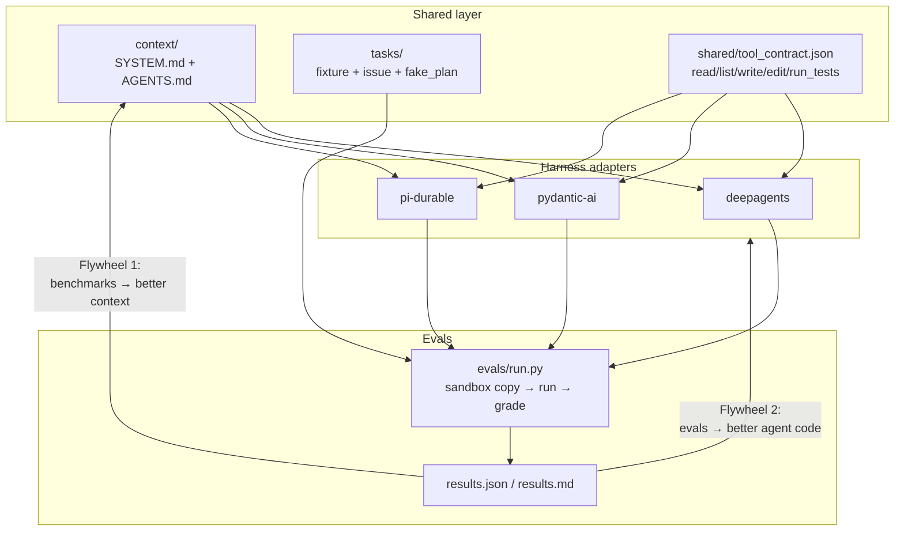

# harness-tests

A long-lived learning repo for comparing **agent harnesses** on the same coding-agent job.

**Harnesses**

| Harness | Language | Package | Superpower |
|---------|----------|---------|------------|
| [Deep Agents](harnesses/deepagents/) | Python | `deepagents` | Planning / subagents / context middleware |
| [Pydantic AI](harnesses/pydantic_ai/) | Python | `pydantic-ai` | Typed tools + clean deps |
| [pi-durable](harnesses/pi-durable/) | TypeScript | `@earendil-works/pi-durable` | Durable crash-resume ([blog](https://earendil.com/posts/pi-durable/)) |

The example agent is small on purpose: given a tiny fixture repo + an issue, it **reads → edits → runs tests → iterates** until green (or gives up).

## Repo layout + flywheels



**Flywheel 1 — improve context:** change prompts, `AGENTS.md`, tool descriptions, or retrieved docs in `context/`; re-run evals; keep changes that help *all* harnesses.

**Flywheel 2 — improve agent code:** change harness glue, tool implementations, or planning strategy; re-run the same tasks; compare steps / tokens / cost.

## Quickstart

### Prerequisites

- Python 3.11+ and [`uv`](https://docs.astral.sh/uv/)
- Node 20+ and `pnpm`
- Optional: `OPENAI_API_KEY` / `ANTHROPIC_API_KEY` for real models

### Install

```bash
uv sync
cd harnesses/pi-durable && pnpm install && cd ../..
```

### Run evals (fake model — no API keys)

```bash
uv run harness-evals --model fake
```

Artifacts land in `evals/output/results.md` and `results.json`.

### Run one harness on one sandboxed task

```bash
# Python harnesses
uv run harness-pydantic-ai --help
uv run harness-deepagents --help

# TypeScript harness
pnpm --dir harnesses/pi-durable exec tsx src/run.ts --help
```

Prefer `harness-evals` so fixtures stay pristine (temp copies).

### Real models

```bash
export OPENAI_API_KEY=...          # or ANTHROPIC_API_KEY
uv run harness-evals --model openai
# optional: HARNESS_OPENAI_MODEL=gpt-4o-mini
```

Without keys, mode defaults to **fake**. Fake mode replays each task's `fake_plan.json` through the shared tools so CI is deterministic.

## Shared contract

- **Tools** — `shared/tool_contract.json` (`list_files`, `read_file`, `write_file`, `edit_file`, `run_tests`)
- **Context** — `context/SYSTEM.md` + `context/AGENTS.md` loaded by every harness
- **Tasks** — `tasks/<id>/{issue.md,fixture/,fake_plan.json,task.json}`

## CI

GitHub Actions runs `uv sync`, `pnpm install`, and `harness-evals --model fake` on every push/PR.

## Next steps

- Add harder tasks (multi-file refactors, failing integration tests).
- Context experiments: ablate `AGENTS.md`, tighten tool descriptions, add retrieved snippets — measure pass rate.
- Deploy the pi-durable agent to **Cloudflare Workers** with durable storage.
- Code-improvement loop: keep a leaderboard of harness×model×prompt commits.
- Wire real token/cost accounting from each provider into `AgentResult`.
- Optional: native fake models inside each harness (`HARNESS_DEEPAGENTS_NATIVE_FAKE=1`, `HARNESS_PYDANTIC_FUNCTION_MODEL=1`) to exercise framework loops without shared short-circuiting.

## Layout

```
context/                 # shared system prompt + AGENTS.md
tasks/                   # benchmark tasks
shared/                  # tool contract, WorkspaceTools, fake agent, results
harnesses/deepagents/    # LangChain Deep Agents adapter
harnesses/pydantic_ai/   # Pydantic AI adapter (underscore = importable package)
harnesses/pi-durable/    # pi-durable TypeScript adapter
evals/                   # cross-harness runner + reports
.github/workflows/ci.yml
```
